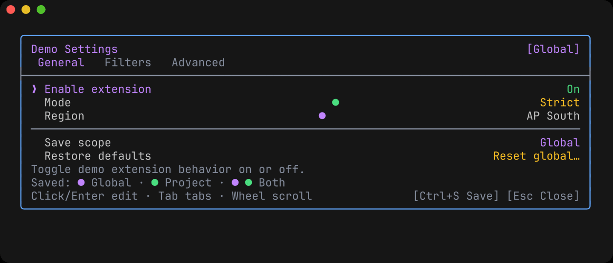
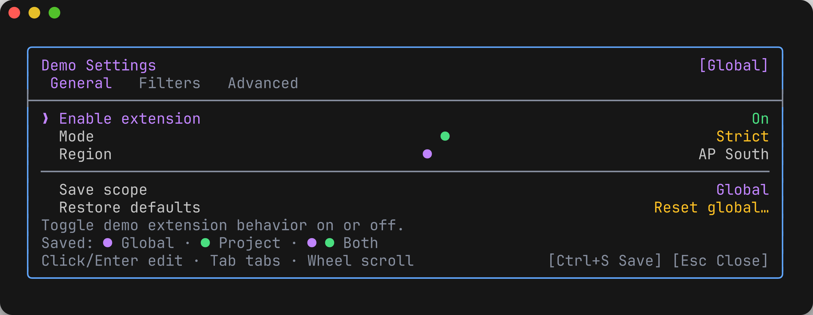
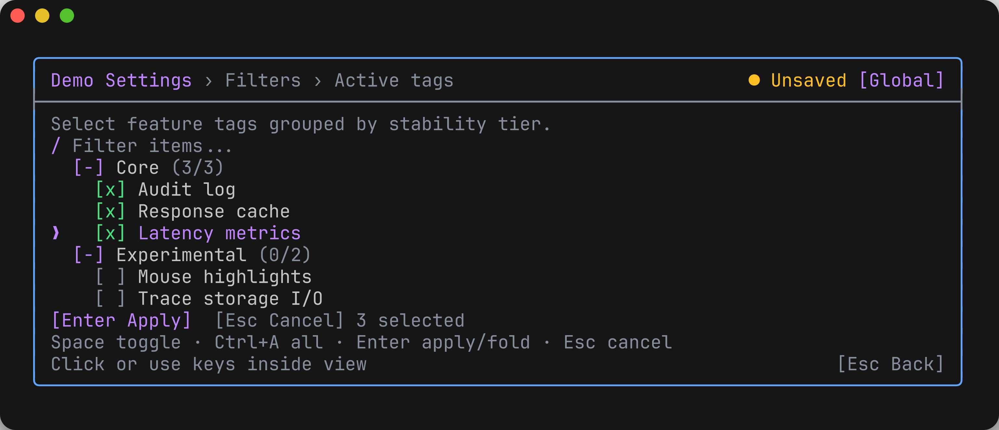

# pi-extension-settings-tui

[](https://www.npmjs.com/package/pi-extension-settings-tui)
[](https://www.npmjs.com/package/pi-extension-settings-tui)
[](./LICENSE)

A declarative settings dialog and layered JSON persistence library for [Pi](https://github.com/earendil-works/pi-coding-agent) extensions, built on `@earendil-works/pi-tui`. Define your schema once to get a themed TUI overlay, fullscreen mouse support, hardened Global/Project overrides, and automatic RPC/headless fallback.

- **Declarative schema + strict TS inference** — `defineSettings` and `field.*` builders infer exact literal union types via `typeof schema.Type`.
- **Single-overlay TUI + fullscreen mouse** — tabs, searchable pickers, collapsible multi-select checklists, first-class Pi model + thinking level picker (Scoped/All + fuzzy search), inline editors, and custom sub-routes with native SGR mouse clicks and wheel scrolling.
- **Global & Project layered overrides** — stores only diffs from defaults, shows provenance dots (`●`), and supports custom file names, path resolvers, or Pi session storage.
- **Hardened atomic I/O** — `0o600` temp-file writes with `fsync`, symlink refusal, 64 KiB cap, secret-key rejection, and optimistic concurrency checks.
- **Automatic RPC & headless fallback** — builds a `ctx.ui.select`/`input` menu in RPC mode and returns resolved settings cleanly in `print`/`json` mode.
- **Zero runtime dependencies** — pure ESM for Node `>=22`.

## Preview



Supports fullscreen mouse clicks and wheel scrolling across tabs, searchable pickers, collapsible multi-select checklists, and Global/Project provenance dots (`●`).

<details>
<summary>Static screenshots (main dialog &amp; multi-select checklist)</summary>

| Settings Dialog | Multi-Select Checklist |
| :---: | :---: |
|  |  |

</details>

## Install

```bash
npm install pi-extension-settings-tui
```

`@earendil-works/pi-coding-agent` (`>=1.5.0`) and `@earendil-works/pi-tui` are optional peer dependencies — already provided inside Pi, and not required for the standalone `/schema` or `/store` subpaths.

## Quickstart

```ts
import type { ExtensionAPI } from "@earendil-works/pi-coding-agent";
import { defineSettings, field, openSettingsDialog } from "pi-extension-settings-tui";

const schema = defineSettings({
  id: "my-extension",
  title: "My Extension Settings",
  settingsFile: "my-extension.json",
  tabs: [{ id: "general", label: "General" }],
  fields: {
    enabled: field.boolean({ tab: "general", label: "Enable extension", default: true }),
    mode: field.enum({
      tab: "general",
      label: "Mode",
      default: "balanced",
      options: [
        { value: "off", label: "Off" },
        { value: "balanced", label: "Balanced" },
        { value: "strict", label: "Strict" },
      ],
    }),
    maxRetries: field.integer({ tab: "general", label: "Max retries", default: 2, min: 0, max: 10 }),
  },
});

export type MySettings = typeof schema.Type;

export default function (pi: ExtensionAPI) {
  pi.registerCommand("my-settings", {
    description: "Open My Extension settings",
    handler: async (_args, ctx) => {
      await openSettingsDialog(ctx, { schema });
    },
  });
}
```

With `settingsFile: "my-extension.json"`, settings automatically mirror to `~/.pi/agent/my-extension.json` (Global) and `<cwd>/.pi/my-extension.json` (Project).

## Documentation

| Guide | Covers |
| :--- | :--- |
| [Getting Started](docs/getting-started.md) | Full walkthrough, reading settings at startup, trying the demo extension |
| [Field Types & Custom Sub-Routes](docs/field-types.md) | `boolean`, `enum`, `multiSelect`, `string`, `number`, `integer`, `model`, `custom` |
| [Storage, Scopes & Security](docs/storage-and-security.md) | Custom file names/paths, Global vs Project layers, session storage, hardening |
| [TUI, Fullscreen Mouse & RPC Fallback](docs/tui-mouse-and-rpc.md) | Keyboard/mouse controls, subpath exports, non-TUI fallback |
| [Demo Extension](examples/demo-extension/index.ts) | Runnable Pi extension showcasing every field type |

## License

[MIT](./LICENSE) © 2026 Arnav Gupta
